# Value Study: design and UX review findings

The review followed [BRIEF.md](BRIEF.md): an interview with the owner first, then the app in use, then an audit against the workflows and the answers. **Nothing in the app was changed.** Each proposal below would be its own pull request once we agree the plan.

**How it was run**
- **Interview:** with the owner, in November 2026.
- **The app:** served locally and driven with Playwright at iPad landscape (1180 × 820), iPad portrait (820 × 1180), Mac (1400 × 900) and phone (390 × 844), with touch emulated on the iPad and phone.
- **References** (open-access paintings from the National Gallery of Art, CC0):
  - George Inness, *The Lackawanna Valley* (landscape);
  - Thomas Barker, *Shepherd Boys and Dog Sheltering from a Storm* (stands in for a pet portrait);
  - Corot, *Ville-d'Avray*.
- **"My study":** a 3-value painted sketch of the Inness, simulated and photographed at an angle on gray paper, then squared up in the app.
- **Mockups:** made by changing the live page in the browser, so the numbers in them are the app's own. Screenshots live in [img/](img/).

---

## The short version

1. **Your app has one core loop, and it isn't the one the toolbar is built around.** You set up a reference (crop, values, grid, maybe a palette), go to **Present** with *Both* showing, and paint. When you need to check, you stop, photograph, and **Compare/Overlay**. You don't use the timer, Reveal, Memory or the Log, yet they hold a top-bar button, a toolbar button and a whole tab.
2. **The Color tab's best tool is the hardest to reach.** Your favorite thing is "pick 3–5 paints and see the picture change". But choosing a palette doesn't change the picture. The button that does is about 2,650 px down the tab, and pressing it moves you to a different tab.
3. **Present needs zoom and a view switch.** At the easel you leave Present to zoom into an eye, or to swap between the original and the study. That's the moment the app should serve best.
4. **"Tap a spot to see how to mix it" is already in the app, buried three taps deep** inside the large color space. It can come out onto the main image, with "add this paint to reach it" when the palette can't.
5. **Modes, as you described them** (they highlight and preset, never hide): **Prepare a painting**, **Value study**, **Color and palette**. They give the app a front door, a sensible order through the tabs, and a guided path for students.
6. **Compare shows two bar charts but doesn't say what's different.** A "where my values differ" layer, a flicker overlay for drawing, and one plain sentence would answer most of your critique wish with what the app already measures.

---

## What I heard: the interview

| Question | Answer, in short |
|---|---|
| **Devices** | MacBook Pro in the browser and iPad Pro, both landscape, about 90% of the time. The phone once or twice, never for a real session. |
| **Most common session** | **(a)** A value study from a photo or painting, painted simply in 3–4 values, in black and white or Payne's gray and white. **(b)** Preparing a reference for a painting (a pet portrait or a landscape): grid it, simplify it, plan the value map, then check whether the planned paints reach the picture. The add/drop suggestions are "super helpful". |
| **Easel routine** | Do all the setup first (image, crop, view tuned, usually **Both**), then **Present**, and leave it. For a bigger image, show the study alone. To check mid-session: stop, wipe hands, photograph, compare. |
| **Workflows actually used** | Value practice (most), reference prep (second), checking my study ("incredibly helpful", both side by side and overlaid), color/palette (often). Master copies: a couple of times. Sync: a few times, helpful. **Never:** Reveal, the gamut mask, the timer, Memory, the Log. |
| **Found / not found** | **Used:** Try presets, Compare palettes, composition guides, custom marker values, keyboard shortcuts. **Seen, not used:** Darks/Middles/Lights, Present (it's used now), Palette tone ("tapped a couple of times"). **Not used:** tapping a stand-in hue, Memory, the Log. **Hadn't found:** tap a color in the large color space to get its recipe. |
| **Wishes** | **Tap a spot on the reference** (any view), perhaps with a long press, for a popup on how to mix it: first from my palette, and if it's out of reach, which paint to add. **Zoom in Present**, to work sight-size: the dog's head the same size on the iPad as on the canvas, then flick between the original and the study. **Feedback when comparing:** drawing accuracy for pet portraits; for landscapes, why it looks off and what would help; and principles, such as Carlson's grouping of planes. |
| **Modes** | Three ways in: **study** (values, maybe a tiny palette), **reference prep** (crop to canvas, grid for transfer, value map), and **analysis** (color and pigments, overlapping with prep). "A mode should **highlight**, not hide": preset things and lead you to features, but you can always override. |
| **Palette sketching** | Try white + Payne's gray, then add cadmium orange, then magenta, and see whether it's a workable, unusual palette without getting the paints out. (Payne's gray itself was just an example; it isn't a gap in the paint list.) |
| **Clutter** | The color space and gamut make the Color tab long and "trying to do too much"; it's more for "the nerd in me" than for reference prep. The **Log hasn't earned a top-level tab.** The timer and Reveal haven't been used. |
| **Other people** | For students, a **guided process**: (1) choose the image, match the canvas proportions, grid and transfer the drawing; (2) choose a value scheme (say 3 values) and decide which shapes to change; (3) use it while painting; (4) a critique: compare the study with the prepared reference. |

### The nine workflows: hypothesis against reality

| # | Workflow (brief) | In practice | What it means for the design |
|---|---|---|---|
| 1 | Quick value practice | **Used most, but untimed.** A study in 3–4 values, gray or one dark + white. | The timer isn't part of it. Value practice = a study setting + Present. |
| 2 | Preparing a reference | **Second most used.** Crop, grid, value map, palette check, Present with Both. | This is the main path. It should be the default mode. |
| 3 | Master copy sessions | A couple of times. | Keep; it lives in Images. |
| 4 | Checking my study | **"Incredibly helpful."** Side by side and overlay; for pet portraits, drawing accuracy. | Worth investing in: make it say what it sees. |
| 5 | Staged reveal | Never used. | Move it out of the main toolbar. |
| 6 | Picture's color | Often, mostly as part of 7. | The color space is reference material: fold it. |
| 7 | Limited palette | The real use is **seeing the picture painted with the palette** and the add/drop suggestions. | Lead the Color tab with it. |
| 8 | Gamut mask | Never used. | Fold it; merge its wheel later. |
| 9 | Across devices | Used, helpful. | Fine as it is. |

---

## Findings, ranked by impact

Each finding names the workflow it affects. **QW** is a quick win: a small, self-contained pull request. **S** is structural: it changes layout or behavior across tabs and needs agreeing first.

| # | Finding | Workflow | Type |
|---|---|---|---|
| 1 | Choosing a palette doesn't change the picture | 7, 2 | QW |
| 2 | The Color tab is three tools in one 3,500–4,400 px column, ordered against how it's used | 6, 7, 8 | QW + S |
| 3 | Present has no zoom and no view switch | 2, 1 | S (medium) |
| 4 | "Tap a spot to see how to mix it" is buried in the large color space | 7, 2 | S (medium) |
| 5 | No modes: every visit starts from the same five tabs | all | S |
| 6 | Compare shows numbers, not differences | 4 | S (medium) |
| 7 | The Palette tone can't do "3 values in a tiny palette" | 1, 7 | S (small) |
| 8 | Timer, Reveal, Memory and Log hold prime space but aren't in the routine | 1, 5 | QW |
| 9 | First run: no sense of what it's for, and live controls that do nothing yet | all | QW (+ 5) |
| 10 | Controls that move you to another tab or change other settings without saying so | 7, 8, 5 | QW |
| 11 | Two look-alike wheels and two look-alike suggestion boxes | 7, 8 | S (after 2) |
| 12 | Crop on iPad landscape: **Apply crop** wraps to a second row, away from Cancel | 2 | QW |
| 13 | Explanations come in many shapes | all | QW |
| 14 | Touch and phone details | all | QW |
| 15 | Design principles: mostly held; two small drifts | all | QW |

---

## Quick wins

### 1. Choosing a palette doesn't change the picture (QW)

**Workflow:** 7, choosing a palette, and 2, reference prep. This is your favorite use of the Color tab.

**What's wrong**
- Choosing a palette, or adding or removing a paint, leaves the study in **Gray**, so nothing on screen changes. In the test, the tone stayed `gray` after choosing the secondary triad.
- The study only shows the palette after you either switch the Study tab's tone to **Palette**, or press **Paint the study with this palette**. That button is about **2,650 px down the Color tab** on the iPad, below the stand-ins, the wheel and the suggestions.
- Pressing it **switches you to the Study tab** (`setPanel('study')`, `js/app.js:2391`). That takes you away from the paints you were tuning, and **Change…** in the Study tab sends you back (`js/app.js:2393`). It's a ping-pong.

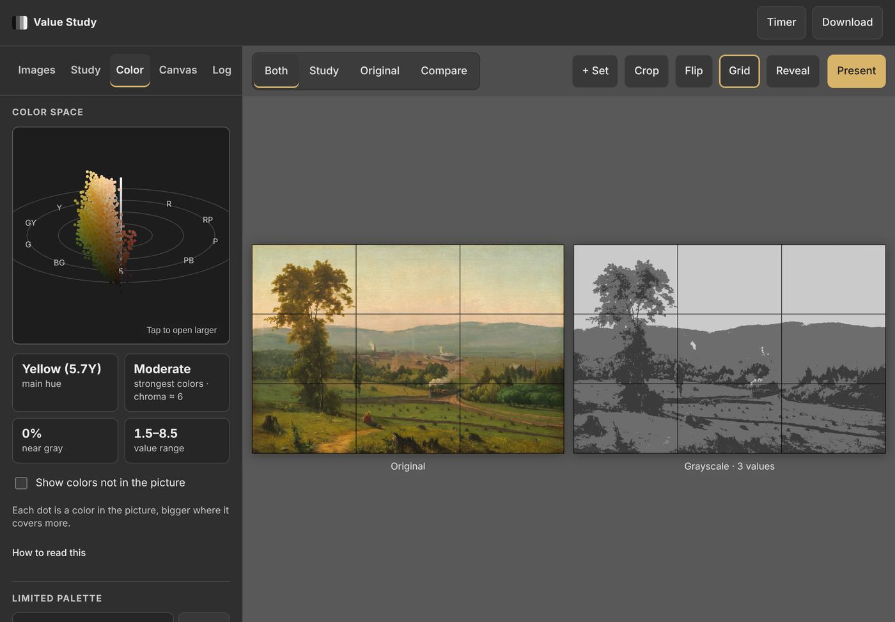

**Proposal**
- Put a **Paint the study with it** switch right under the palette menu.
- Choosing a palette, or changing its paints, turns it on, so the study repaints right away. Remember the tone you had (Gray, say), and turning it off goes back to it.
- Stay on the Color tab. Keep the Study tab's **Palette** tone as the same setting, seen from the other side.
- This is mostly wiring existing pieces together. Mockup in finding 2.

### 2a. Make the palette section compact (QW part of 2)

**Workflow:** 7.

**What's wrong:** on touch screens each paint chip takes a full row.
- Richard Schmid's 15 paints make **834 px of chips** on the iPad.
- The tab is **3,465 px** with the secondary triad and **4,003 px** with Schmid in iPad landscape, **4,440 px** in iPad portrait and **3,452 px** on a phone.

**Proposal**
- Make the chips two per row, or a single row of paint dots with names on tap.
- Move **Add for this picture / Least needed here** and **Compare palettes on this picture…** up, under the reach figures. They're the "super helpful" part.

The structural half of this is finding 2 below.

### 8. Timer, Reveal, Memory and Log hold prime space (QW)

**Workflow:** 1, value practice, and 5, staged reveal.

**What's wrong:** none of these is part of your routine, yet each takes a prime spot:
- **Timer** has a button in the top bar.
- **Reveal** has its own button in the main toolbar, next to Crop and Grid.
- The **Log** is one of five top-level tabs.

They still make sense for practice and for students, so the answer is to move them, not delete them.

**Proposal**
- **Reveal** leaves the main toolbar. It's already in the timer's **Practice** menu. Keep `R`, and show the button in the Value study mode (finding 5).
- The **Log** stops being a tab. It becomes a **Practice log** link at the foot of the Images tab and in the timer bar, and it comes forward in the Value study mode. "Download log" stays with it.
- The **Timer** button stays, since it's small and on the keyboard.
- That leaves four tabs (**Images, Study, Color, Canvas**). It also fixes the one narrow tab button: Log is 41 px wide.

### 9. First run (QW, and finding 5 finishes it)

**Workflow:** all of them; the first minute.

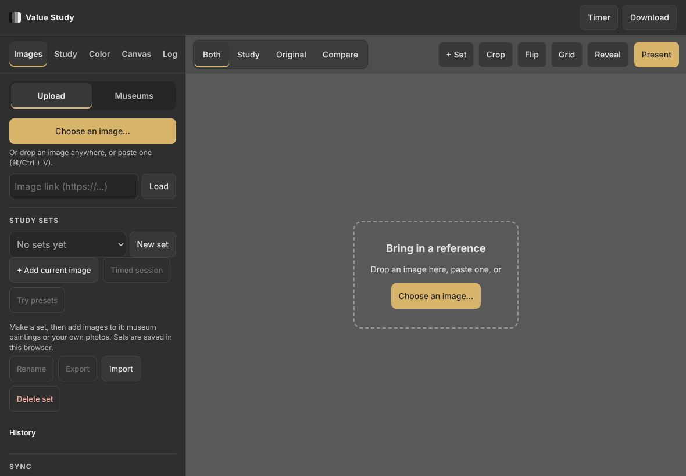

**What's wrong**
- Nothing says what the app does or which way in suits you.
- With no image loaded, the whole toolbar is live and **Present** is the gold primary button (it answers with a toast).
- The Images tab shows **Rename, Export, Delete set, Timed session and Try presets** before any set exists.
- There are two **Choose an image…** buttons.

**Proposal (quick part)**
- Dim the image tools until an image is in.
- Make **Present** primary only once there's something to present.
- Hide set management until a set exists. Show "New set" and a one-line hint instead.
- Offer **Try it on a museum painting** in the empty state: one tap opens a known open-access landscape.

The mode picker (finding 5) is the rest.

### 10. Controls that move you or change other settings silently (QW)

**Workflow:** 7, 8 and 5.

**What's wrong**
- **Paint the study with this palette** changes the tab.
- **Change…** changes it back.
- Turning on **Paint the study inside the mask** switches Gray to Color.
- Pressing a number key in Palette tone quietly switches to Color (`js/app.js:790`).
- Reveal borrows the view, tone and values. It restores them well, but nothing says it's doing so.

**Proposal:** two rules for every control.
- **A control never changes the tab you're on.**
- **When a control changes another setting, say so**, with a short toast and **Undo** ("Switched the study to Color to show the mask · Undo").

### 12. Crop on iPad landscape (QW)

**Workflow:** 2.

**What's wrong:** at 1180 px the crop bar wraps, so **Apply crop**, the primary action, lands alone on a second row at the far left, away from Cancel and Full image.

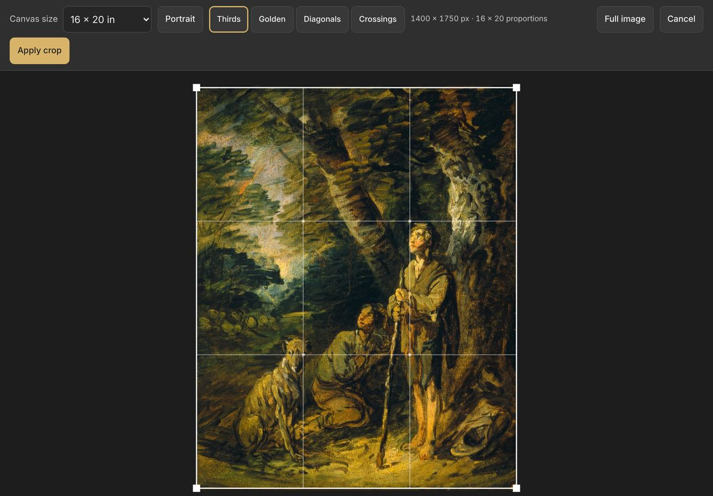

**Proposal:** put the guide toggles on their own second row (or in a small menu), and keep **Cancel · Apply crop** together at the right of the first row.

### 13. Explanations (QW)

**Workflow:** all.

**What's wrong:** explanations come in many shapes:
- four "How to…" boxes (How to read this, How mixing is worked out, How to use a gamut mask, Keyboard shortcuts);
- a "Delete the synced copy" box that is really an action;
- a dozen one-line hints;
- source notes under the palettes.

They vary in length and voice.

**Proposal**
- **One pattern:** one plain sentence under each tool, and a single **?** that opens a short explainer card. Keep the paint sources where they are.
- Make **Delete the synced copy** a plain danger button behind a confirmation, not a disclosure.
- Add a keyboard-shortcuts card on `?`, and keep the list in Canvas. You found it there and use it.

### 14. Touch and phone (QW)

**Workflow:** all.

The 44 px rule holds almost everywhere on iPad sizes. The sweep found these exceptions:

| Where | Size |
|---|---|
| History item **×** and **+** | 30 × 30 |
| Log calendar days | 40 × 40 |
| Log calendar arrows | 40 × 44 |
| The Log tab | 41 px wide |
| Range sliders (Squint, Strength, Size) | 32 px tall |

**Also**
- In Present, **Exit presentation** sits on top of the study's top-right corner.
- On the phone, the view switcher (Both · Study · Original · Compare) is cramped.
- The phone is rarely used, so it's low priority. The proposed changes shorten the Color tab most on the phone (3,452 px today).

### 15. Design principles (QW)

**Workflow:** all.

**What holds**
- Grays are neutral OKLCH tokens (chroma 0).
- The stage is a neutral value of about 4.6.
- Text tokens note their APCA levels.
- Inputs are 16 px on touch.

**Two small drifts**
- The overlap wheel's key uses raw hex colors (`css/app.css:619–621`) instead of tokens.
- The warm gold accent sits right beside the picture: the **Present** fill, and the ring on a pressed **Grid**. The app's own contrast check shows how a warm neighbor shifts how a color reads. Consider a neutral pressed state for toolbar buttons that sit on the stage edge, and keep gold for the one primary action.

---

## Structural changes

### 2. Reorganize the Color tab around the palette (S)

**Workflow:** 6, 7 and 8.

**What's wrong:** the tab holds three tools in the order they were built, not the order you use them:
1. **Color space:** the color space, its figures and its explanation.
2. **Limited palette:** the menu, chips, reach, stand-ins with the contrast check, the overlap wheel, suggestions, and three buttons.
3. **Gamut mask:** shapes, saved masks, the wheel, the palette outline, size, Paints for this mask with suggestions and Build, and the study toggle.

On the iPad the color space alone fills the first screen. The palette starts below the fold, and the button you want is three and a half screens down.

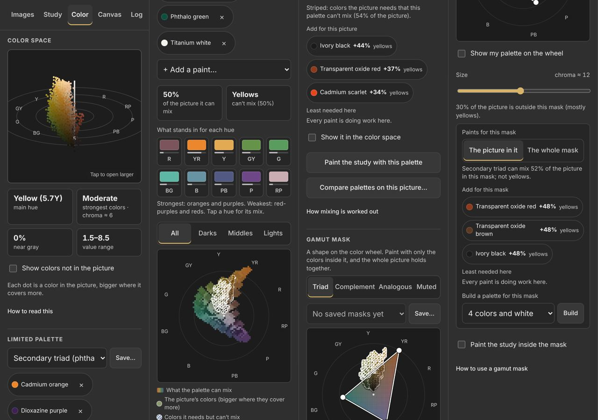

**Proposal: lead with the palette; fold the rest.**
1. **Palette**
   - the menu and Save;
   - the **Paint the study with it** switch (finding 1);
   - compact chips and Add a paint;
   - reach ("50% of the picture · can't mix yellows");
   - **Add for this picture / Least needed here**;
   - **Compare palettes on this picture…**
2. **Explore this palette** (folded): what stands in for each hue with the contrast check; the wheel with Darks, Middles and Lights; Show it in the color space.
3. **The picture's color space** (folded): its title row shows the figures ("Main hue yellow 5.7Y · strongest chroma ≈ 6 · values 1.5–8.5"), so you get the read without opening it.
4. **Plan a color scheme (gamut mask)** (folded): all of the mask tools. It keeps its own place for when you want it.

In the mockup this takes the tab from about 3,500 px to about **1,050 px**, with the picture painted in the palette the whole time.

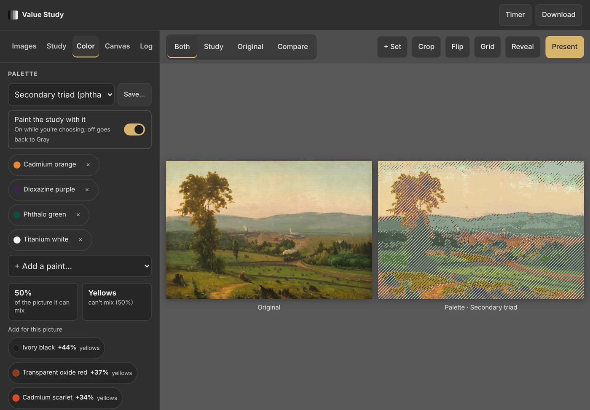

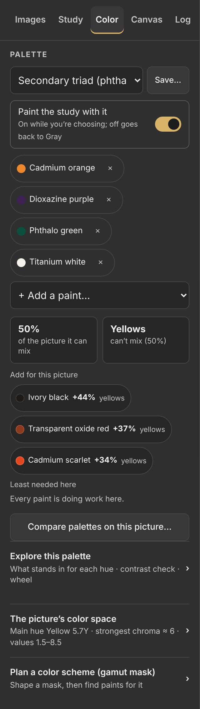

Folding these sections is the conservative move. Two alternatives:
- Rename the tab **Palette** and move the color space and mask into a fifth tab called **Analyze**, using the slot the Log frees.
- Keep one Color tab, but let the mode (finding 5) decide which section is open. I'd start with the folds and judge after using them.

### 3. Present: zoom, pan and a view switch (S, medium)

**Workflow:** 2, reference prep at the easel, and 1, value studies. This is where the app spends the most actual painting time.

**What's wrong**
- Present is a good, big image. On the iPad in landscape, each image is 566 × 707 px with Both.
- But a tap only brings up **Exit presentation**. There's no zoom, no pan, and no way to switch Both / Study / Original without the keyboard.
- To zoom into an eye, you leave Present and pinch the whole page.

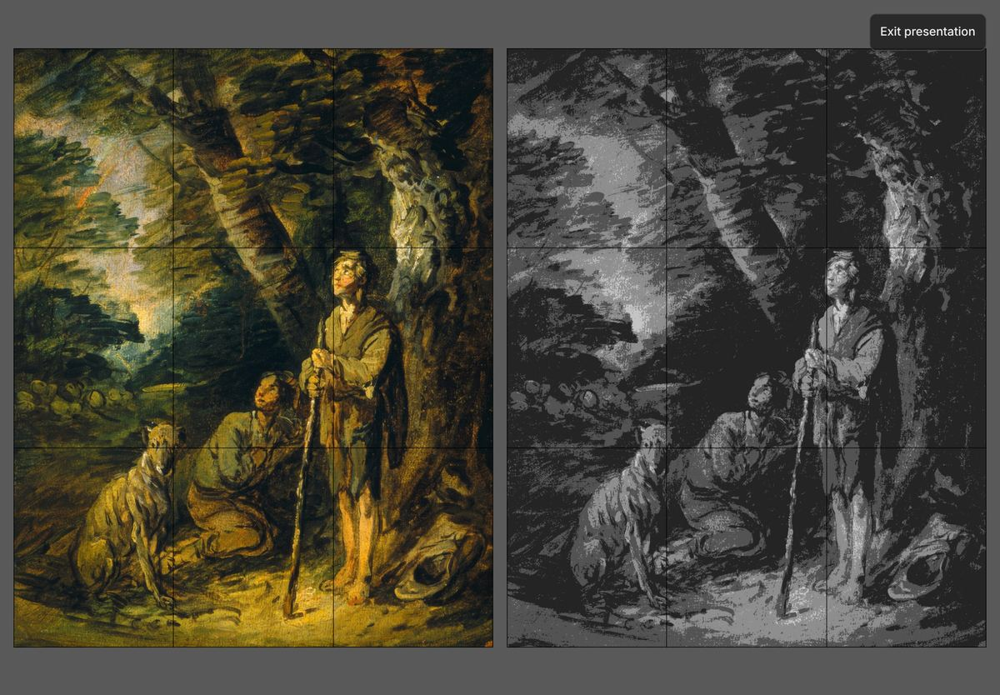

**Proposal**
- A tap shows a small floating bar: **Both · Study · Original**, **− zoom +**, **Fit**, **Grid** and **Exit**. It fades after a few seconds, like the Exit button does now.
- **Pinch and drag** zoom and pan both images **together**, so the original and the study always show the same area.
- **Double-tap** goes back to Fit.
- Zoom is kept per image, so coming back to the painting tomorrow puts the dog's head at the same size.
- Later, and only if it proves useful: a **sight-size** helper. Type how wide the head is on your canvas, measure it once on screen, and the app sets the zoom so it matches.

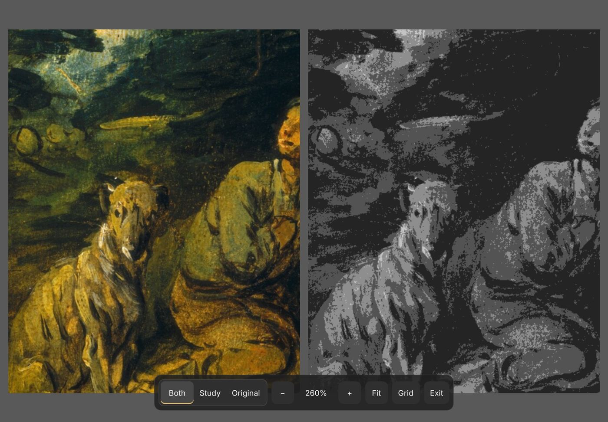

### 4. Tap a spot to see how to mix it (S, medium)

**Workflow:** 7 and 2. This answers your wish directly.

**What's wrong**
- It exists, but only inside the large color space: tap a dot, a copy of the picture appears, then tap the picture.
- The reading gives the Munsell notation and "Your palette: mostly cadmium orange and titanium white, a touch of phthalo green (ΔE 7)", or "Out of your palette's reach…".
- It never suggests what to add.
- You hadn't found it.

**Proposal**
- On the main image (original or study, in any view, in Present too), **tap while the Color tab is open, or long-press anywhere**. A popover shows:
  - the spot's color and Munsell notation;
  - **with your palette:** the closest mix, its recipe, and whether it's close enough ("You can mix it" within ΔE 10, or "Closest you can get, ΔE 17, near but visibly off");
  - **if it's out of reach:** the one or two paints that would reach it, each with its recipe and **+ Add**.
- In the mockup, a dark olive in the Inness foreground can't be mixed from the secondary triad. The app's own figures suggest **green gold** (ΔE 9) or **sap green** (ΔE 10).
- It reuses `PAL.nearest`, `PAL.recipe` and `PAL.build(…, { include })`, the same code behind the add/drop suggestions, so no new color math is needed.
- The large color space keeps its own tap for people who think in 3D.

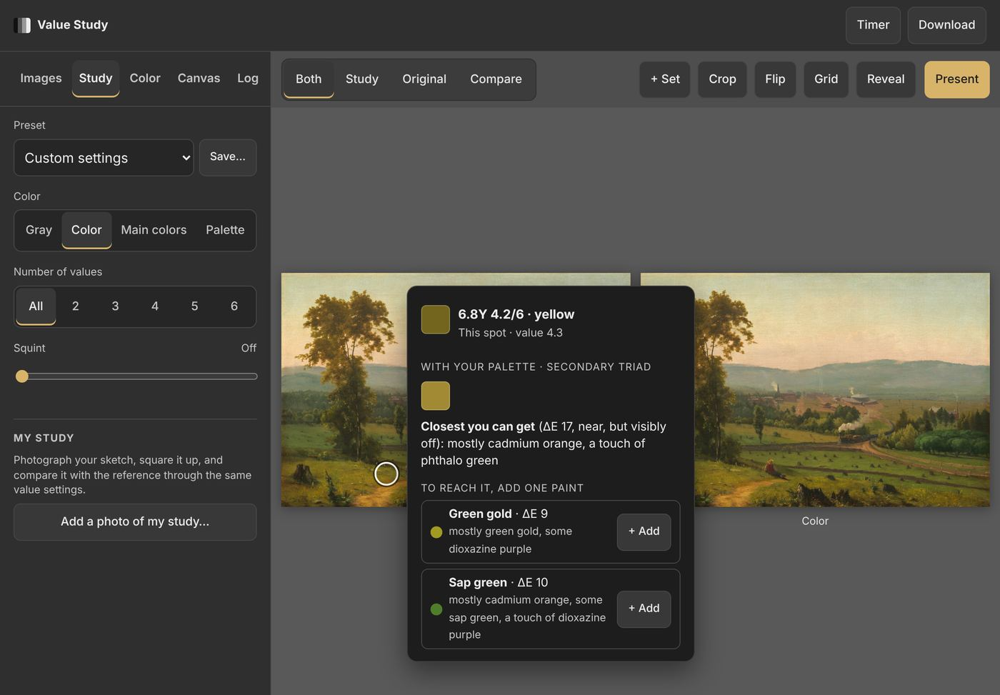

### 5. Modes: three ways in, which highlight and never hide (S)

**Workflow:** all. This answers your "what would a mode mean" and the guided process for students.

**What's wrong**
- Every visit starts at the same five tabs, with every tool equally loud.
- "How the study looks" is spread across Study (tone, values), Color (palette, mask) and Canvas (grid, guides).
- Presets capture only the first of those, and they refuse to save in Palette tone (`js/app.js:3657`).
- You said the hard part is "figuring out what my options are and what's going to be most helpful when I'm in that mode."

**Proposal**

A **mode** is a broader preset plus an order. It never removes a tool.

| | **Prepare a painting** (default) | **Value study** | **Color and palette** |
|---|---|---|---|
| For | A reference for a real painting: landscape or pet portrait | Practice: 2–4 values, maybe a tiny palette | Choosing paints; the "nerd" view |
| Sets | Both view; Gray, 3 values, fit to image; grid on (3 × 3, or square cells); thirds guides in Crop | Study view; Gray, 3 values; squint on | Both view; Palette tone on |
| Opens first | Crop (then Study) | Study | Color, palette section open |
| Brings forward | Crop, Grid, Present, **Check my study** | Present, Timer (with Reveal and Memory in Practice), the Practice log | Tap a spot to mix it, Compare palettes, suggestions |
| Steps strip | Image → Crop → Values → Palette (optional) → Grid → Present → Check | Image → Values → Paint → Check | Image → Palette → Explore |

**How it shows**
- On the **first run**, the empty stage asks "What are you working on?" with the three modes.
- Once an image is in, a **mode line and a steps strip** sit at the top of the sidebar. The next step is ringed, and so is its toolbar button.
- Any step can be skipped. Changing any setting just makes it "custom", as presets already do.

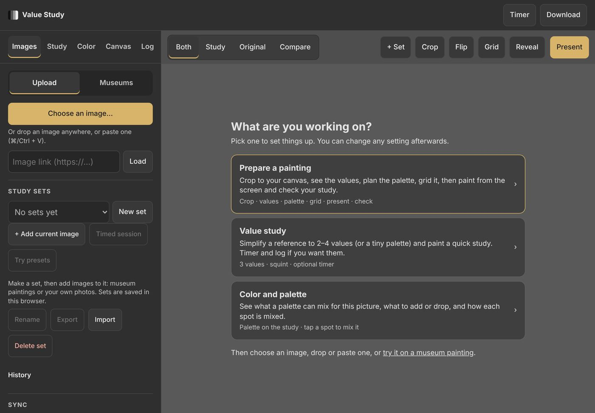

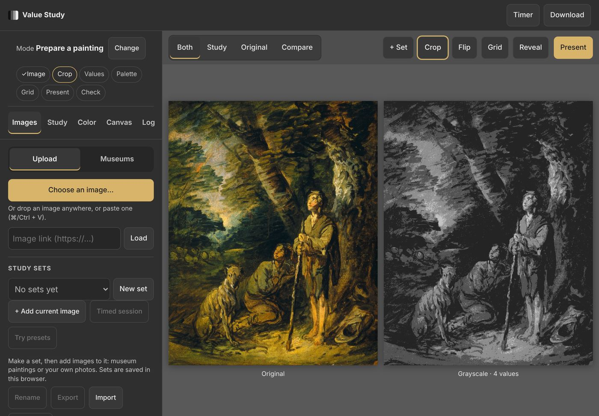

**How to get there in small steps**
1. **Let presets carry more:** the palette (by name), the grid, the guides and the view. Your own presets then become "mini modes", and PLAN.md already lists "grid in presets".
2. **Modes:** three built-in mode definitions, each a broader preset plus a step list. No tool is hidden; the steps only reorder and highlight.
3. **The first-run picker.**
4. **For students:** an exported study set can carry its mode, so a workshop set opens in "Value study, 3 values" for everyone.

### 6. Compare that says what it sees (S, medium)

**Workflow:** 4. "Incredibly helpful" today, and the critique wish.

**What's wrong**
- Compare shows the two studies side by side, with two bar charts stacked in the sidebar.
- In the test, the reference was 21% dark, 45% middle and 34% light, and the sketch was 0% / 13% / 87%. You have to do the arithmetic and the looking yourself.
- **Overlay** is a 50% blend. That's fine for values, but weak for drawing: a blend makes edges mushy, which is exactly what you check in a pet portrait.

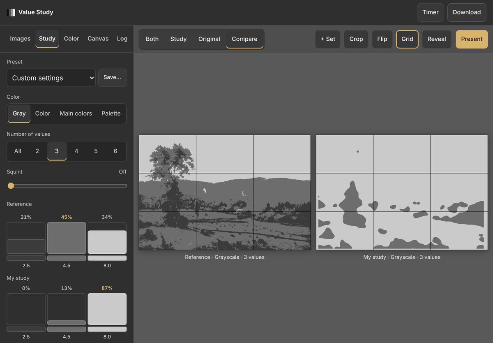

**Proposal: three layers, matching the three kinds of feedback you described.**
1. **Drawing:** two more overlay styles beside the blend.
   - **Flicker:** tap to swap reference and study in place, the classic sight-size check.
   - **Difference:** what doesn't line up glows.

   Both reuse the squared-up study.
2. **Values:** a **"Where my values differ"** layer: blue where your study is a value lighter than the reference, red where it's darker. Add one sentence from the numbers the app already has, such as "Your darkest value is missing: 0% against 21%. The big tree and the near shadows read as middle values, so your light key is higher."
3. **Principles:** see "Ideas that would be new features" below.

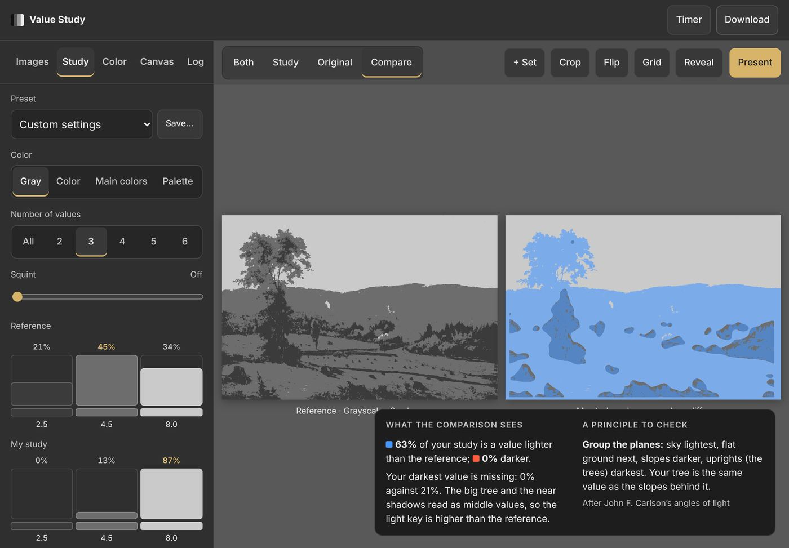

### 7. Palette tone with a number of values (S, small)

**Workflow:** 1, value study with a tiny palette, and 7.

**What's wrong**
- The Palette tone repaints every pixel with its nearest mix, and hides **Number of values**.
- So "3 values in white and one dark", the study you described, can't be shown.
- Pressing a number key there switches the study to Color.

**Proposal**
- Let Palette tone use **Number of values**: group the values first (the same splits as Gray), then paint each value area with the palette's nearest mix at that value.
- With white and one dark, that's your 3-value monochrome study.
- With white, a dark, cadmium orange and magenta, it's a **color thumbnail** in your palette sketch.
- This also lets presets and modes hold "3 values in this palette".

### 11. One wheel, one suggestion box (S, do after 2)

**Workflow:** 7 and 8.

**What's wrong:** the palette's overlap wheel and the mask wheel are the same hue-and-chroma wheel with different layers. The palette's suggestions and the mask's suggestions are the same component with different targets. Side by side, they read as duplicates ("Transparent oxide red +37% yellows" against "+48% yellows").

**Proposal**
- **One wheel with layers:** the picture's colors, your palette's range, and the mask's shape, each switchable. The mask's handles appear when the mask layer is on.
- **One suggestion box** with an **aim:** "this picture", "the picture inside the mask", or "the whole mask".
- Do this after the Color tab is folded (finding 2), since you don't use the mask yet. The merge matters less once the mask is out of the way, and it can be judged then.

---

## Ideas that would be new features

These came up in the interview. They go beyond making existing features work together, so each needs its own yes before any work.

- **Principles beside the comparison.** A short card of "things to check", chosen by subject.
  - **Landscape:** Carlson's grouping of planes (sky lightest, flat ground next, slopes darker, uprights darkest), big shapes first, the light key.
  - **Pet portrait:** where the eyes sit, the angle of the head, the big shadow shapes.
  - Paraphrase with credit rather than quoting at length.
  - Later, the measured layer (finding 6) could point to the principle it bears on ("your trees are the same value as the slopes").
- **A sight-size helper in Present** (finding 3, later step): set the zoom so a feature matches its size on the canvas.
- **Exporting the Log** somewhere more useful than CSV, such as a calendar or a practice tracker. You said the log might be "more interesting passing data onto another source".

---

## New ways to use what's already there

None of these needs new code. A few would be worth a sentence in the README, or a mode.

1. **Palette sketching before a painting.** Palette tone + Add a paint + Compare palettes is a way to try an unusual palette without getting the paints out. For example, start with white and one dark, add cadmium orange, then a magenta, and watch the picture change. With finding 7 it becomes a color thumbnail at 3 or 4 values.
2. **Pet-portrait commissions.**
   - **Setup:** Crop to the canvas size, a square-cell grid for transfer, then Present with Both.
   - **At the lay-in stage, before any paint:** photograph the drawing and use **Overlay** to check placement and proportions.
   - **At the end:** Compare a photo of the finished painting with the reference, and save the comparison sheet with the commission.
3. **Being a palette detective on master paintings.** Open a Payne or an Inness and run **Compare palettes**: which listed palette reaches it best? Then start from three paints and follow **Add for this picture** to see what the master's picture seems to need.
4. **A value-key survey of an artist.** Make a set of 10–20 paintings by one painter and use **Try presets** at 3 values. The contact sheet shows his light key and how he groups masses across his work. Download it as a study page.
5. **A plein air kit from a color scheme.** With no image, shape a **gamut mask** for the day's light (a muted, warm scheme for an autumn evening, say). Use **Build a palette for this mask** with "the whole mask", and pack only those paints.
6. **Framing photos on location.** Crop with the composition guides is a viewfinder. Frame a photo you took on site with the horizon on a third before painting from it.
7. **Value strings for markers or premixed grays.** **Custom** marker values set to the strings you premix (Payne's gray and white at 2, 4, 6, 8) make the study match your actual piles of paint.
8. **Teaching.**
   - Export a curated study set for a workshop, so everyone has the same references.
   - The side-by-side sheet is a ready handout.
   - The comparison sheet is a record of a critique.
   - The Log may earn its place with students practicing daily.

---

## Suggested order of work

One pull request each, smallest and most useful first. Each keeps both test suites passing.

1. **The palette paints the study, and stay on the tab** (findings 1 and 10, part 1)
2. **Fold the Color tab, with compact chips** (2a, then 2)
3. **Present: floating bar, zoom and pan in step** (3)
4. **Tap a spot to mix it** (4)
5. **Tidy up the first run, the toolbar and the tabs:** Reveal into Practice; the Log as a link; the crop bar; touch exceptions (8, 9, 12, 14)
6. **Palette tone with a number of values** (7)
7. **Presets carry the palette, grid, guides and view** (5, step 1)
8. **Compare: flicker, difference, "where my values differ", and one sentence** (6)
9. **Modes and the steps strip, and the first-run picker** (5, steps 2 and 3)
10. **Later, if still wanted:** one wheel with layers (11); explanation cards (13); principles (new features)

## Questions to settle before building

1. **Mode names:** "Prepare a painting", "Value study", "Color and palette"? Should **Prepare a painting** be the default?
2. **Tap to mix:** tap while the Color tab is open, long-press anywhere, or both?
3. **The gamut mask:** fold it in the Color tab (proposed), or give it its own place?
4. **The Log:** a link at the foot of Images and in the timer bar, or somewhere else? Fine to drop the tab?
5. **Present zoom:** remember it per image (proposed), or reset each time?
6. **Students:** is the guided path something to build soon, or after the modes have been tried?

---

Appendix: measurements and method

**Color tab height**

| Size | Height |
|---|---|
| Mac (1400 × 900) | the palette starts near the bottom of the first screen, below the color space and its figures |
| iPad landscape | 3,465 px (secondary triad), 4,003 px (Richard Schmid's 15 paints) |
| iPad portrait | 4,440 px |
| Phone | 3,452 px |
| Mockup B | about 1,050 px |

**Where things sit on the iPad, from the top of the Color tab**
- **Paint the study with this palette:** 2,653 px
- **Gamut mask:** 2,818 px

**Present with Both, iPad landscape:** each image is 566 × 707 px for a 16 × 20 crop.

**Touch sweep:** every visible button, select, input, label and summary in each tab, at iPad landscape with touch emulated. The results are under finding 14.

**Errors:** no page errors in any run. The live sync service and image relay were blocked during the review, so no personal data was touched.

**Screenshots:** the full set (about 60, at four sizes) is outside the repo, in the session's scratchpad. [img/](img/) has the ones used here, as JPEGs.

